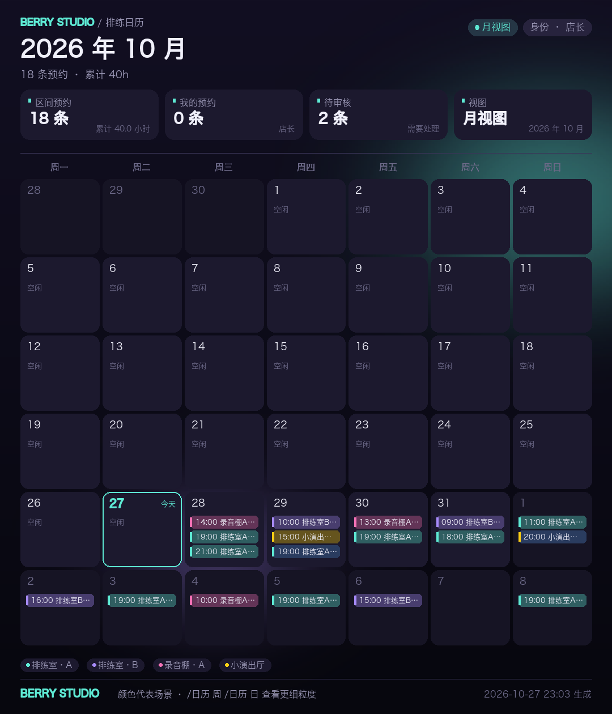
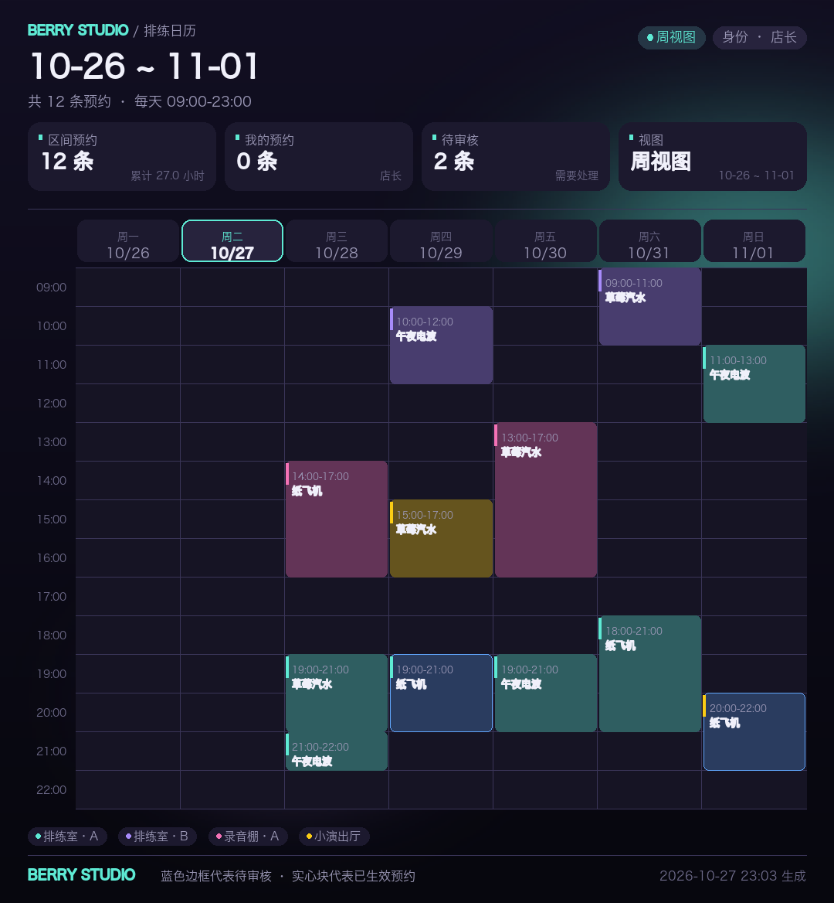
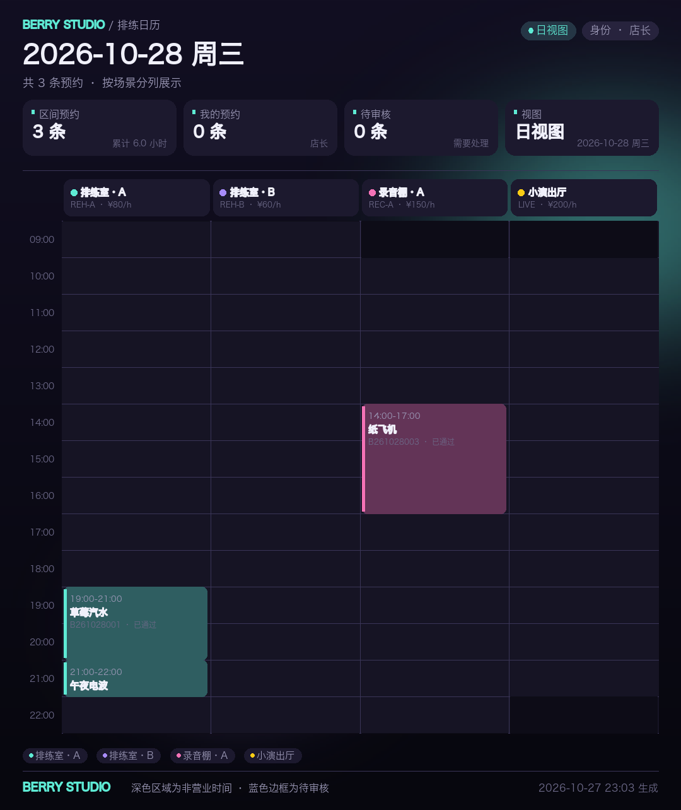
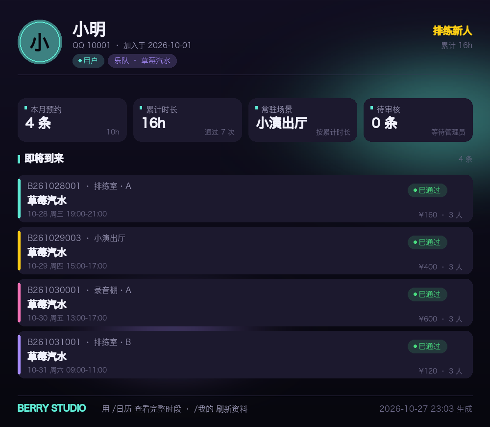
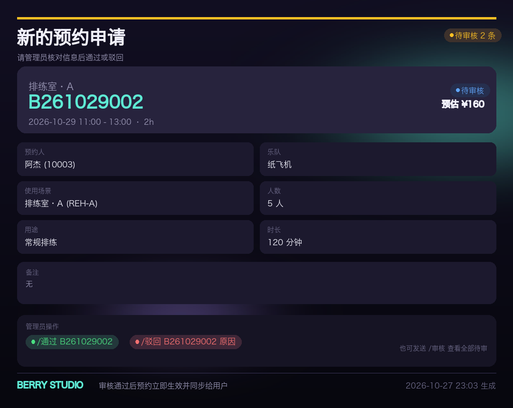
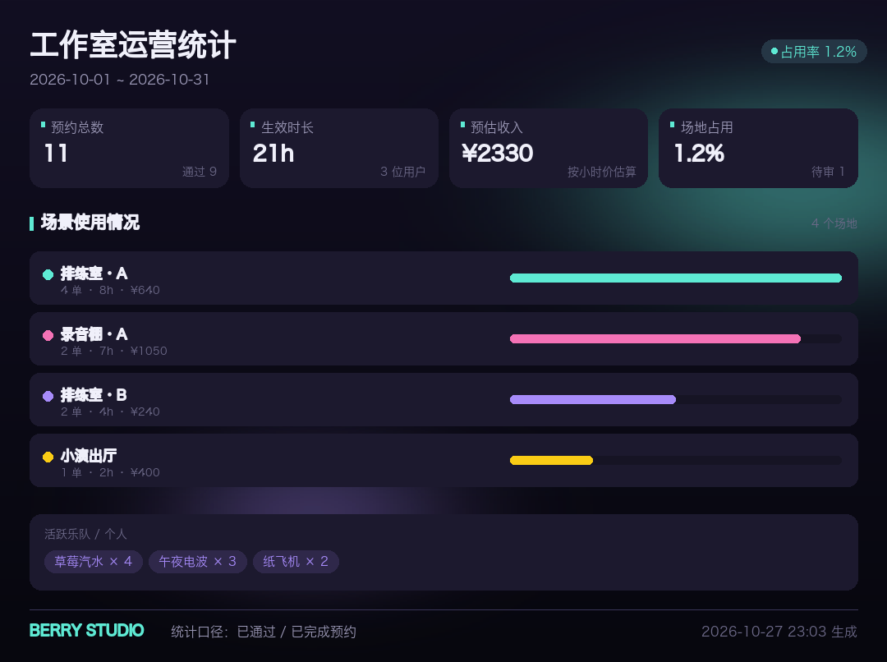

# BerryStudio · 音乐工作室排练预约 QQ 机器人

面向音乐工作室 / 排练房的 QQ 群预约系统：群成员用 `@机器人 /指令` 完成绑定、注册乐队、提交预约；
机器人把新预约自动私聊推送给管理员审核，通过后同步到服务器数据库；用户可查询空闲时段、查看日 / 周 / 月 / 列表四种粒度的日历图片和个人资料卡。

所有业务数据保存在服务器上的 SQLite 文件（`data/berrystudio.db`），无需额外数据库服务。

## 效果预览

| 月视图 | 周视图 |
| --- | --- |
|  |  |

| 日视图 | 个人资料卡 |
| --- | --- |
|  |  |

| 管理员审核卡 | 运营统计 |
| --- | --- |
|  |  |

> 预览图由 `scripts/preview_renders.py` 生成，可随时重新渲染检查排版。

## 功能总览

- **QQ 绑定**：`@机器人 /绑定 昵称`，后端按 QQ 号读取 / 建立用户档案。
- **乐队管理**：创建乐队、邀请码加入、成员 / 队长展示、退出与队长自动交接。
- **预约申请**：`/预约 场景 日期 时段`，支持自然语言日期（明天 / 周三 / 10-28）、时段写法（19:00-21:00、19点-21点、19:00+2h）。
- **管理员审核**：新预约自动私聊推送给全部管理员（含审核卡图片），支持 `/通过`、`/驳回`、`/审核`；审核通过后预约正式生效并回执申请人。
- **冲突保护**：提交时校验时间冲突；审核通过前再次复核，避免管理员误批重复时段。
- **时间量化**：日 / 周 / 月 / 日程列表四种视图；每个场景可单独配置预约粒度（15 / 30 / 60 分钟）。
- **场景可编辑**：排练室、录音棚、演出厅等场景全部存于数据库，管理员可随时新增、改价、改营业时间、关闭预约。
- **图片结果**：深色霓虹风格日历、个人资料卡、审核卡、预约列表、运营统计，全部由 Pillow 在服务器本地渲染。
- **后台管理**：QQ 群指令 + HTTP API + 服务器 CLI 三种方式，覆盖用户、预约、场景、管理员、统计与审计。
- **可扩展存储**：SQLAlchemy ORM + 轻量迁移；每张表都有 `extra` JSON 列，状态字段使用字符串常量，新增功能不需要重建库。

## 目录结构

```
berrystudio/
├── bot.py                      # 机器人入口：初始化 NoneBot、加载插件、启动数据库
├── berrystudio/
│   ├── config.py               # 环境变量配置（时区、预约规则、管理员、字体等）
│   ├── permissions.py          # 权限判定
│   ├── notify.py               # 管理员推送 / 用户结果通知
│   ├── webadmin.py             # FastAPI HTTP 管理后台
│   ├── cli.py                  # 服务器端管理命令
│   ├── db/
│   │   ├── models.py           # ORM 模型（用户 / 乐队 / 场景 / 预约 / 日志）
│   │   ├── session.py          # 引擎、会话、SQLite PRAGMA、写锁
│   │   ├── migrate.py          # 轻量版本化迁移
│   │   └── seed.py             # 默认场景 / 配置管理员自动登记
│   ├── services/               # 纯业务层（不依赖 NoneBot，可被 HTTP / CLI 复用）
│   │   ├── users.py            # 账号绑定、角色、状态
│   │   ├── bands.py            # 乐队与成员
│   │   ├── scenes.py           # 场景增删改查、模糊解析
│   │   ├── bookings.py         # 预约创建 / 审核 / 取消 / 冲突检测 / 空闲时段
│   │   ├── schedule.py         # 日历数据组装
│   │   ├── stats.py            # 个人 / 工作室统计
│   │   ├── audit.py            # 后台审计日志
│   │   └── dto.py              # 与 ORM 解耦的展示对象
│   ├── render/
│   │   ├── theme.py            # 配色、字体、渐变背景、绘制辅助
│   │   ├── calendar.py         # 日 / 周 / 月 / 日程列表图片
│   │   └── cards.py            # 资料卡 / 审核卡 / 预约列表 / 统计卡
│   ├── utils/
│   │   ├── timeparse.py        # 中文日期 / 时段解析
│   │   └── format.py           # 展示格式化
│   └── commands/               # NoneBot 命令插件
│       ├── account.py          # /绑定 /我的
│       ├── bands.py            # /创建乐队 /乐队 /加入乐队 /退出乐队
│       ├── scenes.py           # /场景 /空闲
│       ├── booking.py          # /预约 /取消 /我的预约
│       ├── calendar_cmd.py     # /日历
│       ├── admin.py            # /审核 /通过 /驳回 /管理
│       └── help.py             # /帮助
├── tests/                      # pytest：时间解析、预约流程、场景、渲染、HTTP API
├── scripts/preview_renders.py  # 生成示例图片
├── data/berrystudio.db         # 服务器 SQL 文件（运行后生成）
└── docs/previews/              # README 预览图
```

## 快速开始

### 1. 环境要求

- Python **3.11+**（已在 3.13 测试；依赖 `nonebot2`、`SQLAlchemy 2`、`Pillow 10+`、`FastAPI`）
- 一个 OneBot v11 协议端：[NapCat](https://github.com/NapNeko/NapCatQQ)、Lagrange、go-cqhttp 等
- 服务器上可用的中文字体（macOS / Windows 自带；Linux 建议安装 `fonts-noto-cjk`）

### 2. 安装依赖

```bash
cd berrystudio
python3 -m venv .venv
.venv/bin/pip install -r requirements.txt
```

### 3. 配置

```bash
cp .env.example .env
```

编辑 `.env`：

```dotenv
DRIVER=~fastapi
HOST=0.0.0.0
PORT=8080
COMMAND_START=["/"]
COMMAND_SEP=[" "]

# 至少填一个管理员 QQ（JSON 数组）
SUPERUSERS=["123456789"]

BERRY_TIMEZONE=Asia/Shanghai
BERRY_DB_PATH=data/berrystudio.db
# 需要 HTTP 后台时再填，留空即关闭
BERRY_ADMIN_API_TOKEN=
```

### 4. 启动机器人

```bash
.venv/bin/python bot.py
```

首次启动会自动：

- 建表并写入 4 个默认场景：排练室·A / 排练室·B / 录音棚·A / 小演出厅；
- 把 `SUPERUSERS`、`BERRY_ADMIN_QQ` 中的 QQ 自动登记为管理员；
- 启动 FastAPI，暴露 OneBot v11 接入点与 HTTP 后台。

### 5. 连接 QQ 协议端

以 NapCat 为例，在协议端配置反向 WebSocket：

```
ws://127.0.0.1:8080/onebot/v11/ws
```

或使用 HTTP POST：

```
http://127.0.0.1:8080/onebot/v11/
```

把机器人拉进群，发送 `@机器人 /帮助` 即可看到菜单。

## 命令手册

> 群聊中所有命令都需要 `@机器人` 开头，私聊可直接发送。

### 用户命令

| 命令 | 说明 |
| --- | --- |
| `/绑定 昵称` | 绑定 QQ，创建用户档案 |
| `/我的` | 个人资料卡（本月预约、累计时长、常驻场景、待审核、即将到来） |
| `/创建乐队 名称 [风格] [简介]` | 注册乐队，自动生成邀请码 |
| `/乐队 [名称]` | 不带参数查看自己的乐队；带名称查看成员、队长、邀请码 |
| `/加入乐队 名称或邀请码 [乐器]` | 加入乐队 |
| `/退出乐队 [名称]` | 退出；队长退出时自动把队长交给最早加入的成员 |
| `/场景` | 可预约场景、价格、营业时间、时长规则 |
| `/空闲 场景 [日期]` | 某天剩余空闲时段 |
| `/预约 场景 日期 时段 [选项]` | 提交待审核预约 |
| `/取消 编号 [原因]` | 取消待审核或尚未开始的预约 |
| `/我的预约 [周\|月\|全部\|待审\|已通过\|日期]` | 预约记录图片 |
| `/日历 [日\|周\|月\|列表] [日期] [场景]` | 日历图片 |
| `/帮助` | 命令菜单 |

预约选项（可任意组合）：

```
乐队=草莓汽水  人数=4  用途=录鼓  备注=需要备用鼓棒  时长=2h
```

示例：

```text
/预约 排练室A 明天 19:00-21:00
/预约 录音棚 2026-10-28 14:00+3h 乐队=草莓汽水 人数=5 用途=录鼓
/预约 排练 周三 19点-21点 人数=4
```

### 管理员命令

| 命令 | 说明 |
| --- | --- |
| `/审核` | 待审核预约列表图片 |
| `/通过 编号 [备注]` | 审核通过（可一次传多个编号） |
| `/驳回 编号 原因` | 驳回并通知申请人 |
| `/管理 用户 列表 [关键字]` | 用户检索 |
| `/管理 用户 <QQ\|@某人> [查看\|封禁\|解封\|设为管理员\|取消管理员]` | 用户管理 |
| `/管理 预约 列表 [待审\|已通过\|全部]` | 最近预约 |
| `/管理 预约 <编号> [查看\|取消 原因]` | 预约详情 / 强制取消 |
| `/管理 场景 列表` | 全部场景（含已关闭） |
| `/管理 场景 添加 代码 名称 类型 [时价] [开放=9-23] [最短=60] [最长=240] [粒度=30] [容量=8] [颜色=#5EEAD4]` | 新增场景 |
| `/管理 场景 编辑 代码 名称=xx 价格=90 开放=10-23 粒度=60` | 修改场景 |
| `/管理 场景 关闭\|开启 代码` | 暂停 / 恢复某场景预约 |
| `/管理 管理员 列表\|添加 QQ [昵称]\|移除 QQ` | 管理员管理 |
| `/管理 统计 [开始日期] [结束日期]` | 统计卡（默认本月） |
| `/管理 审计 [数量]` | 最近后台操作 |

## 预约 / 审核流程

1. 用户 `/预约`，服务层校验：账号状态、场景开放、营业时间、时长限制、时间粒度、提前预约范围、人数、待审核数量、时段冲突。
2. 预约写入数据库，状态为 `pending`；同时写入 `booking_logs`。
3. 机器人把审核卡私聊推送给所有管理员；若管理员均无法私聊，按配置回落到触发预约的群聊提醒。
4. 管理员 `/通过 编号`：
   - 再次检查冲突（防止并发或旧数据）；
   - 状态改为 `approved`，记录审核人 / 时间 / 备注；
   - 私聊通知申请人，失败则群里 @ 申请人。
5. 管理员 `/驳回 编号 原因`：状态 `rejected`，释放时段并通知申请人。
6. 预约结束后可由 CLI `archive` 或机器人启动时自动标记为 `completed`。

`pending` 也会占用时段，避免两个用户同时抢到同一档期；被驳回或取消后立即释放。

## 时间写法

日期：

```
今天 明天 后天 大后天
周一 星期三 礼拜五 本周三 下周三 上周五
2026-10-28 2026/10/28 10-28 10月28日 2026年10月28日
```

时段：

```
19:00-21:00
19-21
19点-21点
19:00+2h
19:00+90分钟
19:30            # 使用默认时长（BERRY_DEFAULT_DURATION_MINUTES）
19:00-21:00 时长=2h
```

所有时间按 `BERRY_TIMEZONE` 解析与展示；数据库统一以 UTC 存储。

## 数据库设计

| 表 | 说明 |
| --- | --- |
| `users` | QQ、昵称、角色（user/admin）、状态（active/banned）、`extra` |
| `bands` / `band_members` | 乐队、邀请码、队长、成员与乐器 |
| `scenes` | 场景代码、类型、价格、营业时间、时长限制、粒度、颜色、是否可预约 |
| `bookings` | 编号、场景、用户、乐队、起止时间、状态、人数、价格、审核信息、来源群 |
| `booking_logs` | 每次状态变化的审计轨迹 |
| `audit_logs` | 管理员后台操作（QQ 指令 / HTTP / CLI） |
| `app_settings` | 预留键值配置表 |
| `schema_version` | 迁移版本记录 |

预约编号格式：`B<年月日><3 位序号>`，例如 `B261028001`，方便管理员在群里口头引用。

### 扩展数据库

1. 修改 `berrystudio/db/models.py`；
2. 在 `berrystudio/db/migrate.py` 的 `MIGRATIONS` 末尾追加新版本（`Migration(2, "说明", 执行函数)`）；
3. 运行 `python -m berrystudio.cli init-db` 或重启机器人，自动应用增量迁移。

小字段也可以先放进各表的 `extra` JSON 列，避免频繁改表。

## HTTP 管理后台

在 `.env` 填写 `BERRY_ADMIN_API_TOKEN=一个足够长的随机字符串`，重启后启用。

鉴权：请求头 `X-Admin-Token: <token>` 或查询参数 `?token=<token>`。

| 方法 | 路径 | 说明 |
| --- | --- | --- |
| GET | `/admin/api/bookings?status=pending&date_from=2026-10-01&date_to=2026-11-01` | 查询预约 |
| GET | `/admin/api/bookings/pending` | 待审核列表 |
| POST | `/admin/api/bookings/{code}/approve` | `{"note": "已确认"}` |
| POST | `/admin/api/bookings/{code}/reject` | `{"reason": "设备维护"}` |
| POST | `/admin/api/bookings/{code}/cancel` | `{"reason": "..."}` |
| GET | `/admin/api/users?keyword=` | 用户列表（含预约统计） |
| GET | `/admin/api/users/{qq}` | 用户详情 |
| POST | `/admin/api/users/{qq}/role` | `{"role": "admin"}` |
| POST | `/admin/api/users/{qq}/status` | `{"status": "banned"}` |
| GET | `/admin/api/scenes` | 全部场景 |
| POST | `/admin/api/scenes` | 新增场景 |
| PATCH | `/admin/api/scenes/{code}` | 修改场景（含 `is_bookable`） |
| POST | `/admin/api/scenes/{code}/bookable` | `{"enabled": false}` |
| GET | `/admin/api/stats?days=30` | 统计（今天前后各 N 天） |
| GET | `/admin/api/audit?limit=20` | 审计日志 |
| GET | `/health` | 健康检查 |

示例：

```bash
curl -s -H "X-Admin-Token: $TOKEN" \
  "http://127.0.0.1:8080/admin/api/bookings/pending"

curl -s -X POST -H "X-Admin-Token: $TOKEN" -H "Content-Type: application/json" \
  -d '{"reason":"设备维护"}' \
  "http://127.0.0.1:8080/admin/api/bookings/B261028001/reject"
```

FastAPI 自动提供 `/docs`（Swagger）便于联调；生产环境建议只在内网或反向代理鉴权后开放。

## 服务器 CLI

```bash
PY=.venv/bin/python

$PY -m berrystudio.cli init-db                    # 建表 / 迁移 / 写默认场景
$PY -m berrystudio.cli add-admin 123456789 --name 店长
$PY -m berrystudio.cli list-admins
$PY -m berrystudio.cli list-users --keyword 小明
$PY -m berrystudio.cli user-info 123456789
$PY -m berrystudio.cli list-scenes
$PY -m berrystudio.cli add-scene REH-C 排练室·C --kind rehearsal --price 70 --capacity 6
$PY -m berrystudio.cli update-scene REH-C --set 价格=90 --set 开放=10-23
$PY -m berrystudio.cli scene-bookable REH-C --disabled
$PY -m berrystudio.cli bookings --status pending --limit 20
$PY -m berrystudio.cli bookings --days 30 --csv data/bookings.csv
$PY -m berrystudio.cli approve B261028001 --note 已确认
$PY -m berrystudio.cli reject B261028001 --reason 时段冲突
$PY -m berrystudio.cli stats                        # 本月
$PY -m berrystudio.cli stats --days 30
$PY -m berrystudio.cli archive                      # 归档已结束预约
```

使用 `--db /path/to/other.db` 可以操作其他数据库文件。

## 测试与预览

```bash
.venv/bin/python -m pytest              # 47 个测试：解析 / 预约 / 场景 / 渲染 / HTTP API
.venv/bin/python scripts/smoke_flow.py  # 不连 QQ 的端到端冒烟：绑定 → 建队 → 预约 → 审核
.venv/bin/python scripts/preview_renders.py   # 生成示例图片到 data/images
```

## 部署建议

systemd 示例：

```ini
[Unit]
Description=BerryStudio QQ Bot
After=network.target

[Service]
Type=simple
WorkingDirectory=/srv/berrystudio
ExecStart=/srv/berrystudio/.venv/bin/python bot.py
Restart=always
RestartSec=5
Environment=PYTHONUNBUFFERED=1

[Install]
WantedBy=multi-user.target
```

- SQLite 已启用 WAL 与 15 秒 busy timeout；备份时使用 `sqlite3 data/berrystudio.db ".backup data/backup.db"`，不要直接拷贝正在写入的文件。
- 机器人需要主动私聊管理员，协议端账号务必先与管理员互为好友，否则会走群聊回落提醒。
- 建议把 `BERRY_ADMIN_API_TOKEN` 设成长随机字符串，并通过 Nginx 仅暴露给内网 / 加 Basic Auth。
- 图片渲染需要中文字体：Linux 安装 `fonts-noto-cjk`，或在 `.env` 指定 `BERRY_FONT_PATH=/usr/share/fonts/opentype/noto/NotoSansCJK-Regular.ttc`。

## 常见问题

**Q：管理员收不到预约提醒？**

1. 检查 `.env` 的 `SUPERUSERS` / `BERRY_ADMIN_QQ` 是否填了 QQ 号，或执行 `cli add-admin`；
2. 确认协议端账号已添加管理员为好友（QQ 私聊限制）；
3. 机器人会把提醒回落到触发预约的群聊，可在群里看到提示。

**Q：图片中文显示为方框？**

服务器缺少中文字体。安装 Noto CJK 或设置 `BERRY_FONT_PATH` 指向 `.ttc/.ttf` 文件。

**Q：时间差 8 小时？**

确认 `BERRY_TIMEZONE=Asia/Shanghai`。数据库统一存 UTC，展示层按该时区转换。

**Q：预约提示“需要按 30 分钟对齐”？**

该场景 `slot_minutes=30`，请使用整点 / 半点。管理员可修改场景粒度。

**Q：用户能看见别人约了什么吗？**

普通用户的日历只显示“已占用”，不展示他人乐队 / 昵称；管理员可见完整信息。

**Q：如何彻底删除某场景？**

建议用“关闭预约”保留历史预约关联；如必须删除，先确认没有预约引用该场景，或在数据库层迁移处理外键。

## 后续扩展方向

- 接入定时任务：自动归档、预约前提醒、爽约标记；
- 增加押金 / 付款状态字段与对账导出；
- 场景容量与设备清单（`scenes.extra`）；
- 管理员分级（店长 / 值班）与操作权限细分；
- Web 前端直接复用 `/admin/api`。

---

BerryStudio 只负责工作室内部排期，不存储密码；QQ 身份由协议端提供，管理令牌请妥善保管。
